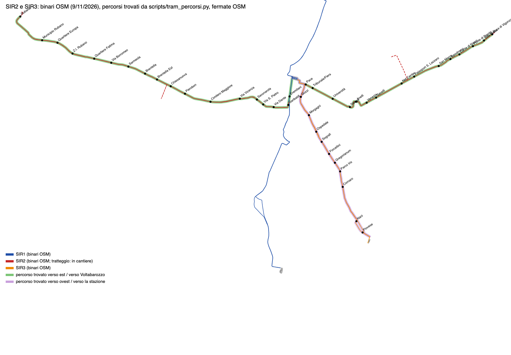

# Nuove linee del tram: SIR3 e SIR2 (ricerca e prova dei tracciati)

Ricerca e piano per portare nel gioco le linee in costruzione. Stato al 9 novembre 2026: qui ci sono le fonti, una
prova di instradamento sui binari OSM (`scripts/tram_percorsi.py`, fuori da `build_map.py`), i dati delle linee
(tappa 1) e il piano. **SIR3 e SIR2 sono nel gioco** (tappa 2, sezione "Nel gioco"): il SIR3 intero fino a Voltabarozzo
(tappa 4, corsia `capolinea`), il SIR2 per il tratto in città. Le tappe del piano sono ordinate per toccare il meno possibile `build_map.py`,
`street_surfaces.py` e `city.js`, che sono della corsia `mappa`.



## Fonti

Lette direttamente il 9 novembre 2026:

* **trampadova.it**, il sito del Comune per il tram (via la sua API WordPress): pagine delle linee, FAQ sul percorso
  del SIR3, notizie dei cantieri e le **mappe KML** delle due linee
  (`https://www.trampadova.it/wp-content/themes/hello-theme-child-master/assets/SIR3.kml`, `SIR2.kml`).
* **Presentazione "Cantieri SIR2 e SIR3"** di APS Holding e Comune di Padova, 2 dicembre 2025, sul sito del MIT:
  https://www.mit.gov.it/nfsmitgov/files/media/notizia/2025-12/01%20Presentazione%20Sistema%20SMART%20-%20Galiazzo.pdf
  (schede delle linee, schema della rete SMART con i nomi delle fermate, mappa dei cantieri a novembre 2025).
* **OpenStreetMap**, export Overpass del 9 novembre 2026 con
  [`scripts/overpass-tram-cantiere.ql`](../scripts/overpass-tram-cantiere.ql), salvato in
  [`data/osm-padova-tram-cantiere.json`](../data/osm-padova-tram-cantiere.json).
* **Wikipedia** "Tranvia di Padova" e "Trams in Padua".
* **Presentazione "Il progetto SIR 2"** di Diego Galiazzo per il dibattito pubblico sul tram, 18 febbraio 2022
  (letta l'11 novembre 2026): https://dptrampadova.it/wp-content/uploads/2022/02/DP-progetto-Galiazzo.pdf. Tavole
  del tracciato a tratti, capolinea di Rubano con il deposito, capolinea di Vigonza, sezione tipo e fermata con
  pensilina. È il progetto del 2022: dove è diverso dalla presentazione di dicembre 2025, da OSM o da quello che si
  sa del cantiere, valgono le fonti più recenti. Dettagli sotto, in "SIR2 nel progetto del 2022".
* Indicazione di chi gestisce il progetto: **il SIR2 prenderà il posto della linea di autobus 10** e avrà **convogli
  da 4 casse**.

Le fermate dei KML e quelle di OSM, in ordine lungo i percorsi, sono in
[`data/tram-fermate-nuove.json`](../data/tram-fermate-nuove.json).

### SIR3 Stazione – Voltabarozzo

* **Dati del progetto** (trampadova.it, 22 marzo 2023): 5,496 km, **13 fermate** a 450 m in media, 3 sottostazioni
  elettriche, **7 convogli da 25 m a 3 casse**, **18 minuti** di percorrenza, 18 km/h di velocità commerciale.
  Presentazione di dicembre 2025: operativa dal 2026, 7 veicoli, **un tram ogni 8 minuti**, 12 fermate (senza contare
  la stazione).
* **Mezzi**: 5 tram a 3 casse sono arrivati al deposito di Voltabarozzo nel 2025 (trampadova.it, 29 gennaio 2025);
  tutti i mezzi nuovi successivi sono a 4 casse e il progetto del SIR3 è stato adattato ai mezzi più lunghi. All'avvio
  il SIR3 va quindi a **3 moduli** (come il SIR1), con banchine pronte per 4.
* **Fermate** (KML): Stazione sud, Pace, Gozzi, Morgagni, Ospedale, Sografi, Forcellini, Gregorianum, Parco Iris,
  Cornaro, Nani, Piovese, Capolinea Voltabarozzo. Nello schema SMART Ospedale si chiama "Ospedale Civile",
  Gregorianum "Sant'Antonio" e il capolinea "Voltabarozzo".
* **Percorso** (FAQ di trampadova.it): stazione, via Gozzi, ponte Omizzolo, via Morgagni, via Giustiniani, via
  Sografi, passeggiata Bianchini, liceo Cornaro, nuovo ponte sullo Scaricatore, Voltabarozzo. Al parcheggio tra via
  Nani e via Michiel si divide: **verso il capolinea per via Giardinetto e via Zeno, verso il centro per via
  Piovese**; i due rami si riuniscono alla rotonda tra via Balestra, via Zeno e via Piovese. Capolinea a destra poco
  prima della tangenziale, con il **deposito di Voltabarozzo** (via Piovese).
* **Stato**: piattaforma finita a marzo 2026; prime prove dalla stazione il 4 maggio 2026; primo viaggio fino alla
  stazione il 5 giugno; posa dei cavi e linea aerea a luglio; obiettivo PNRR certificato il 2 agosto (6,3 km di linea
  e il deposito); da settembre asfaltature e finiture. Obiettivo dichiarato: **servizio entro la fine del 2026**.

### SIR2 Rubano – Busa di Vigonza

* **Dati** (presentazione di dicembre 2025): operativa dal 2027, circa 17,5 km, 26 veicoli, 37 fermate, **un tram
  ogni 6-8 minuti**. Capolinea intermedi sui rami: **Romagnoli** (Chiesanuova) e **Ospedale San Lazzaro** (dopo Net
  Center). Mezzi a **4 casse** (il mezzo n. 31 della flotta SMART, a 4 casse, è arrivato a Rubano il 23 giugno 2026).
* **Sostituisce la linea 10** (Sarmeola/Caselle – Stazione – Ponte di Brenta), che nel gioco c'è già.
* **Percorso**: Rubano, Sarmeola, via Chiesanuova, Cimitero Maggiore, via Vicenza, corso Milano, via Dante, Corso
  Garibaldi, Eremitani, stazione, Pace, via Tommaseo (Fiera, Università), Stanga, via Venezia, via San Marco, Ponte di
  Brenta, Busa di Vigonza.
* **Fermate**: il KML del sito ha un elenco vecchio ("le fermate e le denominazioni saranno definite in base al
  progetto esecutivo": Verdi e Insurrezione al posto delle attuali). L'elenco in OSM corrisponde allo schema SMART:
  Rubano, Municipio Rubano, Quartiere Europa, Z.I. Rubano, Quartiere Fatima, Via Borromeo, Sarmeola, Brentella,
  Brentella Est, Chiesanuova, Pierobon, Cimitero Maggiore, Via Vicenza, Savonarola, Via S. Pietro, Via Dante,
  Garibaldi, Eremitani, (De Gasperi, Stazione), Pace, Tribunale/Fiera, Università, Stanga, Anelli, Venezia, Savelli,
  Net Center, Palasport S. Lazzaro, San Marco, Ippodromo, Dante di Nanni, Ponte di Brenta, Villa Breda, Busa di
  Vigonza. I nomi dello schema SMART a volte sono diversi (Via S. Pietro è "Milano", Stanga è "Stanga - Questura").
* **Stato**: obiettivo PNRR certificato il 2 agosto 2026 (21,3 km di piattaforma, rotaia su oltre 16 km, deposito di
  Rubano); settembre 2026: asfaltature in corso Milano e a Chiesanuova, fermata sud di via Vicenza da finire, via
  Tommaseo dalla stazione alla Stanga a seguire.

#### SIR2 nel progetto del 2022

Dalla presentazione del dibattito pubblico (febbraio 2022, fonti sopra).

* **Numeri**: 17,5 km, 34 + 2 fermate, 84% in sede riservata o separata dalle auto, collegamento di 0,85 km al nuovo
  polo ospedaliero (San Lazzaro), pista ciclabile lungo tutto il tracciato. Nello schema SMART il SIR2 è la linea
  **T2 Rubano – Vigonza** (azzurra); sugli stessi binari T3 Rubano – San Lazzaro, T4 Voltabarozzo – Vigonza, T7
  Guizza – Vigonza.
* **Fermate** nello schema SMART del 2022, da ovest: Rubano Pria Fosca (capolinea), Treviso, Roma, Cimitero Rubano,
  Galilei, Sarmeola, Sant'Antonio, Brentella Ovest, Brentella Est, Chiesanuova, Pierobon, Cimitero, Vicenza,
  Savonarola, Milano, Dante, Garibaldi, Eremitani, Popolo, Stazione PD, Pace, Tribunale – Fiera, Università, Stanga
  Questura, Venezia, Net Center Savelli, Palasport S. Lazzaro, San Marco, Ippodromo, Villa Breda, Ponte di Brenta,
  Busa di Vigonza, Busa di Vigonza RFI (capolinea). L'elenco OSM sopra è più recente e ha qualche nome diverso.
* **Tracciato**, una tavola per tratto, da Vigonza a Rubano: capolinea di Vigonza (stazione di Busa di Vigonza,
  tangenziale nord, rotonda per Venezia / SR11); fiume Brenta e Villa Breda; Ponte di Brenta; ippodromo e autostrada
  (tangenziale est); via San Marco e via Einaudi (raccordo Gandhi); collegamento al nuovo ospedale (fermata FS);
  cavalcavia San Marco – via Friburgo (Net Center); via Venezia; Stanga; Fiera e università; stazione (Tribunale,
  corso del Popolo, via Gozzi); Scrovegni e Arena (giardini dell'Arena, via Trieste); centro storico (piazza
  Insurrezione, corso Milano); via Vicenza (sopra la ferrovia Padova – Bologna); Chiesanuova (Cimitero Maggiore,
  corso Australia); Chiesanuova Pierobon (caserma); Chiesanuova Romagnoli (ex caserma, fiume Brentella); Rubano
  Brentelle (SR11 via della Provvidenza); Rubano via Po – via Borromeo; Rubano zona industriale (cimitero); Rubano via
  Europa; Rubano centro (via Roma, municipio); Rubano centro (via Palù); capolinea di Rubano (via Pria Fosca).
* **Capolinea di Vigonza**: nel progetto del 2022 la linea arriva da Ponte di Brenta, gira alla rotonda per Venezia /
  SR11, prosegue verso est accanto alla stazione di Busa di Vigonza, sale lungo la ferrovia fino alla tangenziale
  nord e finisce in un capolinea con un grande parcheggio scambiatore. **Oggi il capolinea è prima della rotonda per
  Venezia / SR11** (indicazione di chi gioca, 11 novembre 2026): il tratto oltre la rotonda, la fermata della stazione
  e il parcheggio non ci sono. Nel gioco il SIR2 finisce prima della rotonda.
* **Capolinea di Rubano**: in via Pria Fosca, a est della SR11 e della sua rotonda, accanto a un grande parcheggio
  scambiatore a nord della via. Ci si arriva dalla SR11: all'altezza di via Palù i binari lasciano la statale verso
  nord, girano attorno all'isolato e corrono verso ovest su una via parallela alla SR11, con una fermata a metà, fino
  al capolinea. Dopo la banchina i binari proseguono verso est ed entrano nel deposito.
* **Deposito di Rubano** (tavola "Rubano capolinea"): a est del capolinea, oltre la via d'accesso, su un lotto
  allungato da ovest a est, più largo a ovest, con il lato nord in diagonale, tutto bordato di verde. Misure lette a
  occhio dalla tavola: il lotto è circa due volte e mezza più lungo che largo.
  - **Ingresso** nell'angolo sud-ovest: due binari arrivano dal capolinea, salgono verso nord lungo il lato ovest e si
    aprono a ventaglio con gli scambi.
  - **Due rimesse** affiancate nella metà ovest, lunghe da ovest a est, una sopra l'altra: capannoni passanti con
    5-6 binari ciascuno, a cui si entra dai due lati con un ventaglio di scambi a ogni testata.
  - **Anello** attorno a ciascuna rimessa e uno esterno che le gira tutte e due: il tram fa il giro senza invertire.
  - **Officina** a nord-est: un edificio quadrato con 5-6 binari che entrano da est, con le fosse di manutenzione
    (le fasce grigie alle due estremità dei binari).
  - Tra rimesse e officina una fascia stretta da nord a sud (forse l'impianto di lavaggio); lungo il lato nord un
    edificio lungo e stretto in diagonale e un binario che corre lungo il confine fino all'angolo nord-est.
  - **Lato est**: i binari curvano verso sud e tornano a ovest lungo il lato sud, chiudendo il giro; al centro della
    parte est un'aiuola ovale grande.
  - Lungo il lato ovest tre piccoli edifici (guardiola, uffici, cabina elettrica?) e uno nell'angolo sud-ovest; strade
    interne asfaltate attorno alle rimesse.

  Nell'export OSM del 9 novembre a Rubano ci sono solo due binari tronchi (`service=spur`) vicino a 45,4335 N,
  11,7802 E: il deposito va disegnato dalla tavola (e dalle foto aeree quando ci saranno), con le misure dei tram a 4
  casse (33 m).

  **Foto aerea del cantiere** (vista di chi gioca, 11 novembre 2026; non nel repository): il lotto del capolinea e del
  deposito sta a nord-ovest di via Pria Fosca, tra la rotonda in fondo a via Pria Fosca (a sud-ovest, vicino al
  distributore e al McDonald's) e via Palù con la sua rotonda (a nord-est); a nord-ovest confina con i campi. I binari
  corrono lungo via Pria Fosca, dalla rotonda verso nord-est; più o meno a metà c'è la struttura della banchina, e una
  curva entra nel lotto verso nord. In fondo al lotto, verso nord, c'è il capannone lungo della rimessa; a destra, verso
  via Palù, gli edifici dell'officina e dei servizi. Il resto è ancora cantiere. Per la disposizione sul terreno vale
  la foto più della tavola del 2022, che non dice com'è orientata.

  **In OSM l'11 novembre** (Overpass; non ancora negli export del repository) il lotto è mappato e torna con la foto:
  `landuse=industrial` "Deposito Rubano" (way 1453139702, gestore Busitalia Veneto, circa 10,7 ha, dalla rotonda di
  via Pria Fosca a via Palù e lungo i campi fino a 45,4363 N), con un ritaglio `landuse=commercial` vicino alla
  rotonda di via Palù (1453139703); la rimessa (1453139704, `depot=tram`, 107 × 37 m, lunga quasi da sud a nord); i
  due binari tronchi (1453139695, 1453139696), due comunicazioni (1453139699, 1453139700) e le due banchine in
  costruzione (1453139697, 1453139698) a metà di via Pria Fosca. Nel gioco la rimessa c'è già, da Overture: stessa
  misura, ma circa 20 m più a ovest e girata di una decina di gradi rispetto alla way di oggi.
* **Sezione tipo** (incrocio canalizzato, 24 m da sud a nord): marciapiede 1,50, pista ciclabile 2,50, banchina 0,50,
  corsia per le auto 3,50, **due corridoi del tram da 3,50** (veicolo largo 2,20, 1,30 tra i due tram), due corsie per
  le auto da 3,50 (una di svolta), banchina 0,50, marciapiede 1,50. I **pali della linea aerea stanno ai bordi della
  strada**, dietro i marciapiedi, con un tirante su tutta la carreggiata che regge i fili sopra i binari al centro.
* **Fermata con pensilina** (lunga 33 m): rampa 3,50, 2,00, **pensilina di 17 m** in 10 moduli da 1,70 (biglietteria
  automatica nel primo), 14 m di banchina scoperta; banchina larga 2,05, alta 25 cm sulla strada, con il parapetto
  verso le auto. È la fermata per i tram a 3 casse (Translohr di allora); per quelli a 4 casse la banchina si allunga.

### Stazione e rete SMART

* Estate 2025: nel piazzale della stazione è stato costruito l'**anello ad alta capacità** per tutte le linee SMART (un
  tram ogni 4 minuti). Alla fine i binari formeranno **due quasi-ovali concentrici, uno interno e uno esterno**,
  percorsi in senso antiorario (verso ovest sul lato nord, verso est sul lato sud). **Oggi il SIR1 usa quello
  esterno.** Le due fermate nuove, **Stazione nord** e **Stazione sud**, stanno sui due lati lunghi del piazzale e
  servono entrambi gli anelli (disegno del progetto con le due fermate sui binari affiancati). Mancano ancora la
  linea aerea nell'anello e le fermate stesse, che in OSM non ci sono.
* In OSM l'anello esterno è la way 966705982 (`oneway=yes`, SIR1); l'interno è mappato come `service=siding`, senza
  senso unico, con raccordi corti. **Senza l'anello esterno nessuna delle quattro prove riesce**: l'anello interno in
  OSM non è collegato in modo percorribile alle uscite verso Pace e Corso del Popolo. Per il gioco la geometria della
  stazione va disegnata dal progetto (o aspettata in OSM), con la scelta dell'anello per ogni linea.
* La fermata **Trieste** del SIR1 è chiusa da settembre 2025: la sostituisce **De Gasperi**, a pochi metri, adatta ai
  tram più lunghi del SIR2. Neanche De Gasperi è in OSM.
* Lo schema SMART di dicembre 2025 prevede linee passanti che combinano i binari di SIR1, SIR2 e SIR3 (T1 Pontevigodarzere
  – Guizza, T2 Rubano – Vigonza, T4 Rubano – Legnaro, T6 Ospedale San Lazzaro – Legnaro, T7 Pontevigodarzere – Legnaro,
  T11 Vigonza – Guizza, T12 Ospedale San Lazzaro – Guizza, T21 Romagnoli – Ospedale San Lazzaro, T22 Romagnoli –
  Vigonza), con prolungamenti a Legnaro e oltre Vigonza. Per il gioco bastano per ora SIR2 e SIR3 come linee proprie;
  il grafo dei binari (piano, tappa 2) deve però permettere queste combinazioni.

## Cosa c'è nei dati

**GTFS.** Il feed Busitalia (BusOne, valido dal 4 novembre al 3 dicembre 2026) ha solo `TPD_SIR1`: niente tracciati,
fermate né orari per SIR2 e SIR3. Gli orari vanno generati dalla frequenza.

**OSM** (`data/osm-padova-tram-cantiere.json`):

| | Binari `railway=tram` | In cantiere | Fermate (`railway=tram_stop`) |
|---|---|---|---|
| SIR3 | circa 10,6 km (doppio binario, deposito) | – | 12 nomi, una per verso, sul binario; manca la stazione |
| SIR2 | circa 30,7 km (doppio binario da Rubano alla Busa di Vigonza) | 2,8 km: i rami di Romagnoli e Ospedale San Lazzaro | 33 nomi, una per verso, sul binario; mancano De Gasperi e la stazione |

Nessuna relazione `route=tram` per SIR2 e SIR3 (solo per il SIR1). I nomi delle way non sono uniformi ("SIR 3",
"SIR3", "Linea SIR3", "SIR 2 Rubano-Vigonza") e non hanno `ref`. L'export che usa oggi il gioco
(`data/osm-padova-tram.json`, 5 novembre) prende solo un riquadro attorno al centro e solo `railway=tram`.

## Prova di instradamento

`scripts/tram_percorsi.py` costruisce il grafo dei binari OSM, anche quelli in cantiere (sensi unici rispettati,
niente curve oltre 60° ai nodi), e cerca il percorso più corto che tocca le fermate del KML in ordine. Ogni fermata
del KML si aggancia alle fermate OSM con lo stesso nome (una per verso, quindi il percorso sceglie il binario giusto);
dove i binari corrono affiancati vale la marcia a destra (il binario contromano costa il triplo). Le fermate OSM che
cadono sul percorso diventano l'elenco della linea.

```bash
python3 scripts/tram_percorsi.py data/osm-padova-tram-cantiere.json SIR3.kml SIR3 "Stazione sud" "Capolinea Voltabarozzo" sir3-andata.json
python3 scripts/tram_percorsi.py data/osm-padova-tram-cantiere.json SIR3.kml SIR3 "Capolinea Voltabarozzo" "Stazione sud" sir3-ritorno.json
python3 scripts/tram_percorsi.py data/osm-padova-tram-cantiere.json SIR2.kml SIR2 "Capolinea Rubano" "Busa Di Vigonza" sir2-est.json
python3 scripts/tram_percorsi.py data/osm-padova-tram-cantiere.json SIR2.kml SIR2 "Busa Di Vigonza" "Capolinea Rubano" sir2-ovest.json
```

| Prova | Lunghezza | Contromano | Fermate OSM sul percorso |
|---|---|---|---|
| SIR3 Stazione → Voltabarozzo | 5350 m | 10 m | 11 (il percorso finisce al punto del KML, poco prima della fermata del capolinea) |
| SIR3 Voltabarozzo → Stazione | 5569 m | 25 m | 12 |
| SIR2 Rubano → Busa di Vigonza | 16 276 m | 45 m | 33 |
| SIR2 Busa di Vigonza → Rubano | 16 660 m | 58 m | 33 |

* Le lunghezze tornano: 5,5 km per il SIR3; per il SIR2 16,3-16,7 km sulla linea principale, contro i 17,5 km
  dichiarati con i rami. I pochi metri contromano sono scambi e incroci.
* Il SIR3 segue i due rami di Voltabarozzo come dice la FAQ (Giardinetto/Zeno all'andata, Piovese al ritorno).
* Il SIR2 tra Garibaldi e la stazione usa i binari del SIR1 (Corso Garibaldi, Corso del Popolo) e passa dall'anello.
* Con l'export del 5 novembre (solo il centro) il SIR2 era coperto da Brentella a Savelli e andava contromano per
  2,4 km da Pace alla Stanga; con quello del 9 novembre lo scambio di Pace c'è e la linea è completa.
* Correzioni a mano rimaste: la fermata Pace del KML del SIR3 è oltre il bivio, sui binari del SIR2 (lo script usa la
  Pace OSM sul tratto comune); le fermate della stazione si agganciano per posizione, perché in OSM non ci sono.
* In stazione tutte e quattro le prove passano dall'**anello esterno**, l'unico percorribile in OSM: il tratto della
  stazione è quindi provvisorio finché non c'è la geometria dei due anelli (vedi sopra).

**Area di gioco.** Dal 9 novembre l'area comprende il corridoio del SIR3 (celle da 250 m attorno ai binari, in
`build_map.py`): tutte le fermate fino a Voltabarozzo e il deposito sono dentro. Dall'11 novembre anche quello del
SIR2: tutte le 35 fermate nei due versi, da Rubano (capolinea in via Pria Fosca, a est della rotonda della SS11) a Busa
di Vigonza (capolinea su via Padova, prima della rotonda con la SR515 e la SR11 per Venezia; i binari dei dati finiscono
al bordo della rotonda). Il tratto del progetto del 2022 oltre la rotonda, fino alla stazione di Busa e al parcheggio
scambiatore, non c'è. Strade e segnaletica delle due teste vengono da un export a parte (`data/osm-corridoio.json`):
l'export delle strade `data/osm-padova.json` a ovest arriva solo fino a lon 11,81. Il deposito di Rubano non è
disegnato (corsia `tram-turni`).

## Dati delle linee (tappa 1)

`scripts/tram_linee.py` scrive [`data/tram-linee-nuove.json`](../data/tram-linee-nuove.json): per linea (colore dei KML
del Comune, moduli, frequenza) e per verso il percorso sui binari OSM (lat/lon, con da 90 a 160 m di binario prima
della prima fermata e dopo l'ultima), le fermate in ordine con la progressiva `s` in metri e il lato della banchina
(`lato`, -1 a sinistra), gli `offsets` in secondi e le partenze feriali e festive `[ora, durata]` come le linee della
mappa.

```bash
python3 scripts/tram_linee.py data/osm-padova-tram-cantiere.json data/tram-fermate-nuove.json data/tram-linee-nuove.json
```

* **Stazione**: SIR2 e SIR3 passano dall'anello interno, il SIR1 resta sull'esterno. In OSM l'anello interno e i quattro
  raccordi tra i due anelli ci sono e sono collegati, ma senza senso unico: lo script li percorre in senso antiorario.
  Stazione nord e Stazione sud stanno sui lati lunghi dell'anello interno, tra i raccordi (55 m di rettilineo, ci sta
  un convoglio da 4 casse). Il SIR3 arriva da Pace sul lato nord, ferma a Stazione nord, gira l'anello e finisce a
  Stazione sud, da dove riparte; il SIR2 verso est ferma a Stazione sud, verso ovest a Stazione nord e poi scende sul
  binario del SIR1 nel Corso del Popolo.
* **De Gasperi** è sul Corso del Popolo dove il KML del SIR2 aveva Trieste, un nodo per binario.
* **Fermate ai capolinea e banchine OSM**: per ogni verso la fermata è il nodo OSM sul suo binario (con i due binari a
  meno di 8 m si prendevano scambiate, a Voltabarozzo); dove OSM ha la banchina (`railway=platform`) la fermata va a
  metà banchina, perché nel gioco il punto della fermata è il centro della banchina.
* **Depositi**: `scripts/tram_depositi.py` scrive [`data/tram-depositi.json`](../data/tram-depositi.json), le way OSM
  attorno ai depositi della Guizza (export del SIR1) e di Voltabarozzo (cantiere), senza le comunicazioni dei
  capolinea; il gioco ne fa il grafo del deposito (`TramYard` in `src/tram/tram.js`).

  ```bash
  python3 scripts/tram_depositi.py data/osm-padova-tram.json data/osm-padova-tram-cantiere.json data/tram-depositi.json
  ```
* **Banchine**: a destra del verso di marcia, come le poche banchine delle linee nuove già in OSM; in stazione stanno
  dentro l'anello interno, quindi a sinistra (porte a sinistra).
* **Orario**: SIR3 ogni 8 minuti, 18 minuti da capolinea a capolinea; SIR2 ogni 7 minuti, 54 minuti a 18 km/h
  (velocità commerciale del SIR3, quella del SIR2 non è pubblicata). Dalle 5.40 alle 7 e dalle 21 ogni 15 minuti, dalle
  20 alle 21 ogni 10; festivi ogni 15 minuti, ogni 30 dopo le 21. Sosta di 20 s a ogni fermata. Il ritorno del SIR3
  arriva in stazione un minuto prima di una partenza dell'andata e il tram riparte subito: la sosta lunga la fa a
  Voltabarozzo, non sulla banchina di Stazione sud che usa anche il SIR2.

| Linea e verso | Percorso | Fermate |
|---|---|---|
| SIR3 → Voltabarozzo | 5390 m | 13, da Stazione sud a Voltabarozzo |
| SIR3 → Stazione | 5531 m | 14, da Voltabarozzo a Stazione nord e Stazione sud |
| SIR2 → Busa di Vigonza | 16 277 m | 35 |
| SIR2 → Rubano | 16 318 m | 35 |

## Nel gioco (tappa 2)

* **Una sede per linea**: `city.tramTracks[id]` (`TramTrack` in `src/tram/tram.js`), con `city.tramTrack` che resta il
  SIR1. Le sedi del SIR3 e del SIR2 partono dai binari di `data/tram-linee-nuove.json` (in `src/data/padova.js`
  `TRAM_LINES` comprende le due linee, con `building: true`, e `net.tramLines` i loro binari).
* **Grafo dei binari**: le sedi si posano una dopo l'altra (SIR1, SIR3, SIR2). Dove il binario di una linea corre sopra
  quello di una sede già posata, nello stesso verso, entro 1,5 m e per almeno 20 m, ne prende i punti (`track.shared`):
  i tram delle due linee viaggiano sulla stessa rotaia, che si disegna una volta sola, e le fermate in comune
  (Eremitani, Stazione sud e Stazione nord) hanno una banchina sola. Ai capi del tratto in comune c'è uno scambio
  (`track.switches`: verso, progressiva, punto, unione o diramazione, binario dell'altra sede), con un raccordo di 20 m
  sul binario che si stacca. Il verso -1 di una linea può correre anche sul suo verso +1 (l'anello del SIR3).
* **Tratto in città**: le fermate con una strada della mappa entro 120 m, la serie più lunga di fila. SIR3 da Stazione
  sud a Cornaro (10 e 11 fermate) fino al corridoio del 9 novembre, ora intero (13 e 14 fermate); SIR2 da Cimitero
  Maggiore a Savelli (16 fermate); i binari arrivano 150 m oltre. Le corse tagliate si chiamano come quelle del SIR1,
  per esempio "Savelli (per Busa di Vigonza)".
* **Menu**: SIR3 e SIR2 nell'elenco del tram dopo il SIR1, con la scritta "in costruzione" e il nome della linea intera.
* **Tram automatici** dall'orario generato, ognuno sulla sede della sua linea e con i suoi moduli. Al capolinea ad
  anello del SIR3 il tram prosegue sul binario della corsa dopo senza cambiare cabina; il giocatore fa lo stesso con B
  negli ultimi 200 m dell'anello.
* **Incroci con le strade** cercati su tutte le sedi; nei tratti in comune l'incrocio è uno solo, con un riferimento
  per ogni linea che ci passa.
* **Precedenze tra tram**: agli scambi cede chi ha il muso dietro; se ognuno vede l'altro davanti (rami che si uniscono,
  incroci a raso tra binari) cede il tram entrato in servizio dopo. Incroci a raso tra linee: SIR2 verso est sul
  binario del SIR1 verso sud in Corso Garibaldi, ritorno del SIR3 sul SIR2 verso est a Pace.
* **Tram e bus**: finché la sede non è nella pianta delle strade (tappa 3) i binari sono disegnati sopra l'asfalto e
  in diversi tratti la corsia dei bus ci passa sopra o a meno di 2,5 m (linea 10 per circa 2 km sul SIR2; linee 4, 5,
  6, 9, 14, 15B, 24 e 42 tra 0,3 e 1,2 km sul SIR3), come già succede col SIR1 in Corso del Popolo e sulle Riviere. Un
  tram aspetta un bus solo se il bus è tutto davanti al muso; dopo 20 s fermo dietro un bus passa lo stesso. Senza
  queste due regole bus e tram affiancati si aspettavano a vicenda per sempre. Due fermate dei bus restano senza
  palina perché la palina cadrebbe sui binari: Sografi 31 (via Sografi, SIR3) e Grassi (Cittadella) (via Venezia,
  SIR2).
* **Prove** (40 minuti di gioco alle 8.15 e alle 17.30, il giocatore lontano dai binari): nessun tram fermo fuori dalle
  fermate; corse guidate intere del SIR3 nei due versi (fino all'anello) e del SIR2 nei due versi.

## Binari della stazione (11 novembre)

Tre foto di chi gioca dell'11 novembre: alla banchina di Stazione sud il binario di destra (l'anello esterno del SIR1)
fa una S verso sinistra e si unisce a quello della banchina; dove il SIR3 entra nell'anello girando a sinistra la curva
è spigolosa; all'uscita della banchina i binari si intrecciano a S e si incrociano più volte. Le cause, nei dati:
l'anello esterno viene dallo shape GTFS del SIR1 agganciato a tratti ai binari OSM e corre a 2-4 m dall'interno, a
volte si avvicina e si fonde con lui; le due testate est si sovrappongono e si incrociano; i raccordi OSM verso Pace e
verso ovest girano con raggi di 8-12 m; gli scambi tra gli anelli sono lunghi 10 m.

**Riferimento: il rendering del progetto del piazzale** (immagine mandata da chi gioca, non nel repository). Ne ho preso:

* due anelli ovali concentrici attorno all'isola dei bus, percorsi tutti e due in senso antiorario;
* i lati lunghi dritti e paralleli tra loro (le banchine e le pensiline del tram corrono lungo il lato verso il piazzale
  pedonale della stazione);
* le testate a semicerchio, con i binari dei due anelli concentrici a distanza costante;
* i raccordi verso le vie con curve morbide, senza S né intrecci; dove OSM fa S e intrecci vale il rendering.

Non ne ho preso la posizione delle banchine: nel gioco restano Stazione nord e Stazione sud sui due lati lunghi, dentro
l'anello interno (scelta della tappa 2), e la topologia resta quella di OSM: quattro scambi tra gli anelli, uscita e
entrata verso Pace a est, verso Corso del Popolo e la Stazione FS a ovest.

**Come** (`scripts/tram_stazione.py`, usato da `tram_linee.py` per SIR2 e SIR3 e da `build_map.py` per il SIR1, così
binari del gioco e sede nella pianta delle strade seguono la stessa geometria):

* anello interno: lo stadio (due lati dritti paralleli e due semicerchi) che segue meglio l'anello interno di OSM (way
  1332833374, 966705987, 966705990, ricampionate ogni metro): raggio delle testate 13,2 m, lunghezza 142 m, asse a
  12,8° sotto l'est; i lati stanno sul binario OSM (scarto mediano 0, al più 0,6 m);
* anello esterno: lo stesso stadio allargato di 3,4 m, l'interasse del doppio binario del gioco: le due corsie rosse si
  toccano come nel rendering (i binari OSM dei lati lunghi stanno a 4,0 m, e con 4 m restava una striscia d'asfalto
  tra le due sedi);
* ogni binario che corre lungo gli anelli in senso antiorario, nella fascia da 2 m dentro l'interno a 5 m fuori
  dall'esterno, va sull'anello più vicino (sotto 1,2 m dall'interno è interno); dove passa dall'uno all'altro uno
  scostamento a S di 24 m (raggio minimo 34 m), centrato dove passava il binario OSM, uguale per tutte le linee che
  usano lo stesso scambio;
* dove arriva da una via o ci va, un raccordo rettilineo, arco, rettilineo con il raggio più grande che sta tra il
  binario com'era 20 m prima e l'anello 14 m dopo. Il SIR2 verso Rubano esce a nord-ovest lungo la testata esterna e si
  innesta tangente sul binario verso sud (prima girava con 8 m di raggio).

Raggi minimi nel piazzale dopo: SIR1 16,3 m, SIR2 verso Busa di Vigonza 16,3 m, le testate dell'anello interno 13,2 m
(SIR3 e SIR2, la larghezza del piazzale in OSM). Fuori dalla stazione i binari restano quelli di prima punto per punto.

**Nel gioco** (`TramTrack` in `src/tram/tram.js`): la media mobile che leviga i punti GTFS rumorosi non tocca i binari
della stazione (`tramStazione` nella rete: centri delle testate, raggio, fascia; la scrive `build_map.py` dallo stesso
modulo), perché restringerebbe le testate interne più di quelle esterne. I tratti in comune tra le sedi finiscono dove
il binario comincia a staccarsi, non a 1,5 m, e oltre si sfuma solo lo scarto rimasto: prima la prima metà della S
finiva schiacciata sull'altro binario e il resto faceva un gradino (le foto). Il binario in comune è il più vicino, non
il primo della lista: il SIR2 resta sulla S del SIR3 fino all'anello esterno.

**Prove**: `tests/stazione-tram.spec.js` guida SIR3 e SIR2 nei due versi attraverso gli anelli (tutte le fermate, senza
urti); 40 minuti di tram automatici alle 8.15 e alle 17.30 senza tram fermi fuori dalle fermate; foto dall'alto e dalla
cabina nei tre punti delle foto di chi gioca.

**Aperto**: le banchine sul lato del piazzale pedonale come nel rendering (oggi una per lato lungo, dentro l'anello
interno).

## Piano

Prima il SIR3 (apre per primo e la parte nel gioco è quasi tutta già dentro la mappa), poi il SIR2.

1. **Dati delle linee, senza toccare la mappa** (fatto, vedi sopra). Uno script nuovo, sulla base di `tram_percorsi.py`, scrive
   `data/tram-linee-nuove.json`: per linea e verso il percorso sui binari (lat/lon), le fermate OSM in ordine con la
   progressiva, il numero di moduli (**SIR3: 3**, **SIR2: 4**) e l'orario generato (SIR3 ogni 8 minuti e 18 minuti da
   capolinea a capolinea; SIR2 ogni 6-8 minuti, tempi tra le fermate dalla velocità commerciale). Aggiunge a mano le
   fermate che OSM non ha (Stazione nord/sud, De Gasperi). Rischio di conflitto nullo: file nuovi.
2. **Grafo dei binari nel gioco** (fatto, vedi sopra). `TramTrack` (in `src/tram/tram.js`) oggi è un solo tracciato con due versi, costruito
   da `net.tram`. Diventa una sede per linea (`city.tramTracks[id]`), con `city.tramTrack` che resta il SIR1, così il
   resto del codice non cambia subito. Poi un grafo vero (rami e scambi) per i **due anelli della stazione** (ogni
   linea percorre il suo, il SIR1 l'esterno; le fermate Stazione nord e Stazione sud servono entrambi) e per i tratti
   comuni (SIR2 sul SIR1 tra Garibaldi e la stazione, SIR2 e SIR3 fino a Pace). Gli anelli si disegnano dal progetto
   del piazzale, perché in OSM l'interno non è collegato alle uscite. Tocca `tram.js`, `traffic.js` (TramSim),
   `main.js`, `mission.js` e la parte del tram di `city.js`. I convogli a 4 moduli (circa 32 m) sono già previsti
   da `modules` (vedi `docs/prompt-tram.md`): vanno provati sulle curve dell'anello e di via Tommaseo.
3. **Sede tranviaria nella pianta delle strade.** `build_map.py` passa a `street_surfaces.surfaces()` le corsie del
   tram: vanno aggiunte quelle di SIR3 e SIR2, e i bus non devono trovarsi la sede in corsia (verifica del CLAUDE.md).
   È la tappa che si sovrappone di più al lavoro sulla mappa: farla **dopo** che l'altra sessione ha unito il suo.
4. **Area di Voltabarozzo** (fatta il 9 novembre dalla corsia `capolinea`): invece di un riquadro `FOCUS`, un corridoio
   di celle da 250 m attorno ai binari del SIR3 (`CORRIDOI_TRAM` in `build_map.py`), con strade, edifici e deposito
   fino al capolinea. DBGT, DTM, segnaletica e paline c'erano già; servivano gli edifici Overture. I binari del
   deposito (OSM `service=yard`) non sono disegnati. Per il SIR2 lo stesso corridoio chiede export nuovi (vedi
   [`ESTENSIONE_LINEE.md`](ESTENSIONE_LINEE.md), sezione 6).
5. **SIR3 nel gioco** (fatto, intero dal 9 novembre): linea nel menu del tram (3 moduli), tram automatici dall'orario generato, fermate con banchina,
   scambio all'uscita dell'anello.
6. **SIR2 nel gioco** (fatto per il tratto in città): il tratto da Cimitero Maggiore a Savelli (come "tratto in città"), 4 moduli, binari in comune
   col SIR1 e col SIR3. **La linea 10 esce di servizio** quando c'è il SIR2: serve uno scenario (per esempio "oggi"
   con SIR1 e linea 10, "rete SMART" con SIR1, SIR2, SIR3 e senza linea 10) oppure si toglie la 10 quando il SIR2
   entra nel gioco. I rami di Romagnoli e Ospedale San Lazzaro (ancora in cantiere in OSM) e i capolinea fuori dalla
   mappa vengono dopo.

Deciso il 9 novembre: le linee nuove vanno accanto alla rete di oggi, nello stesso elenco del SIR1 nel menu del tram,
con un'indicazione che le distingue (linea in costruzione). Niente scenario "rete SMART" per ora: la linea 10 resta
tra gli autobus.
